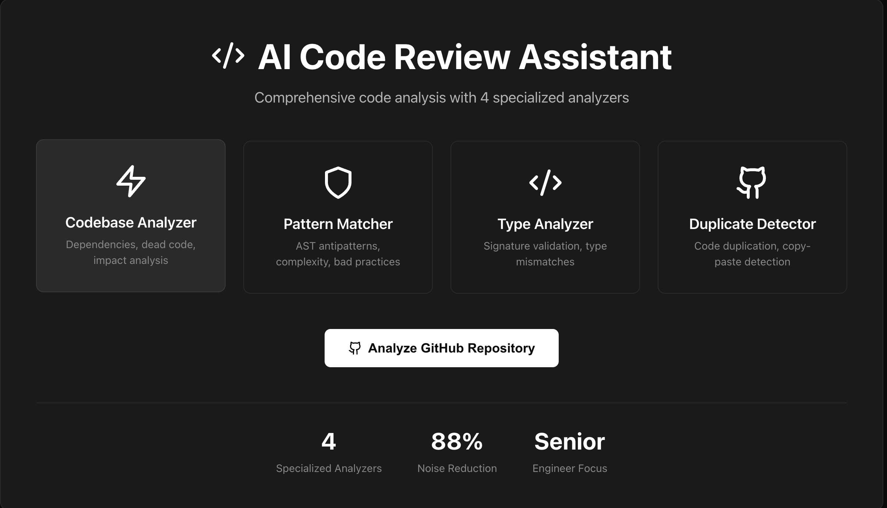
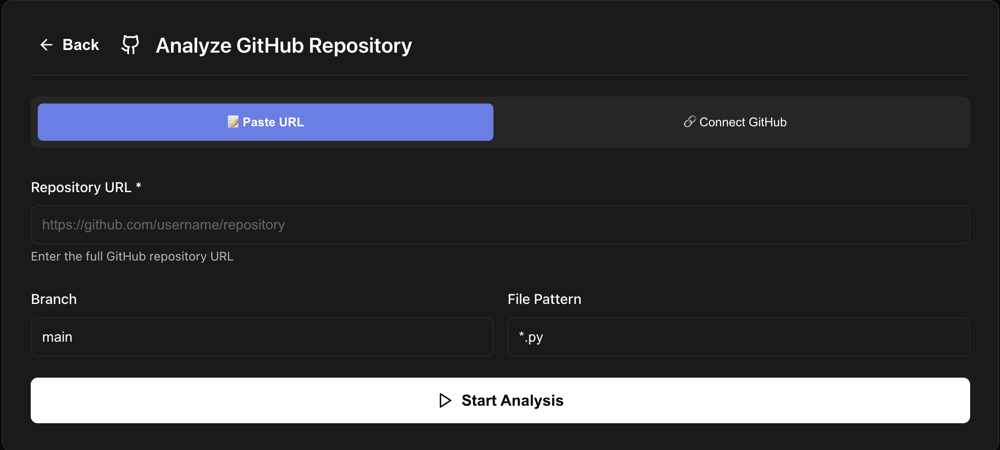
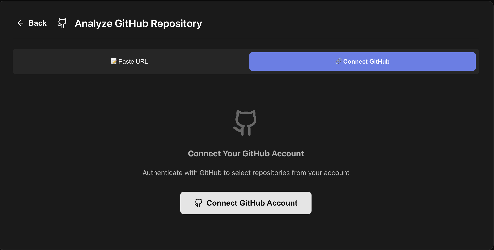
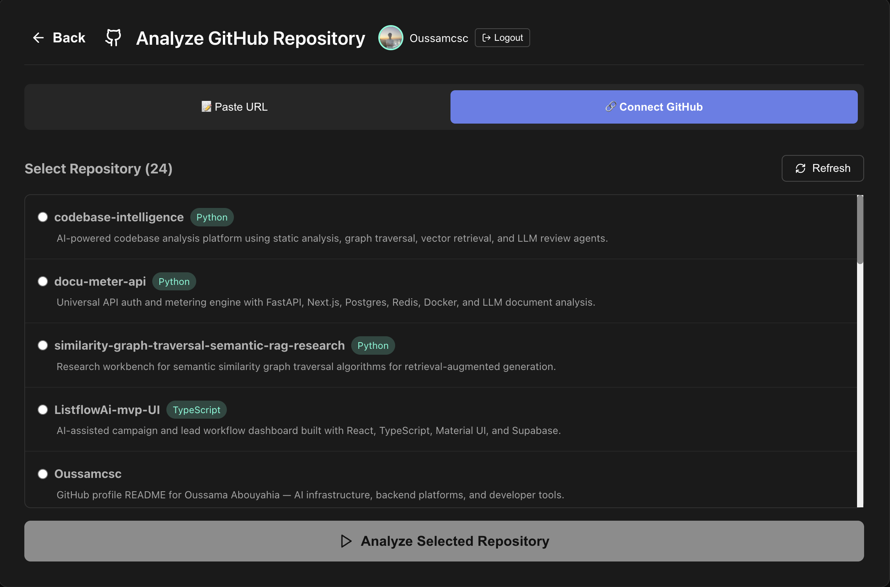
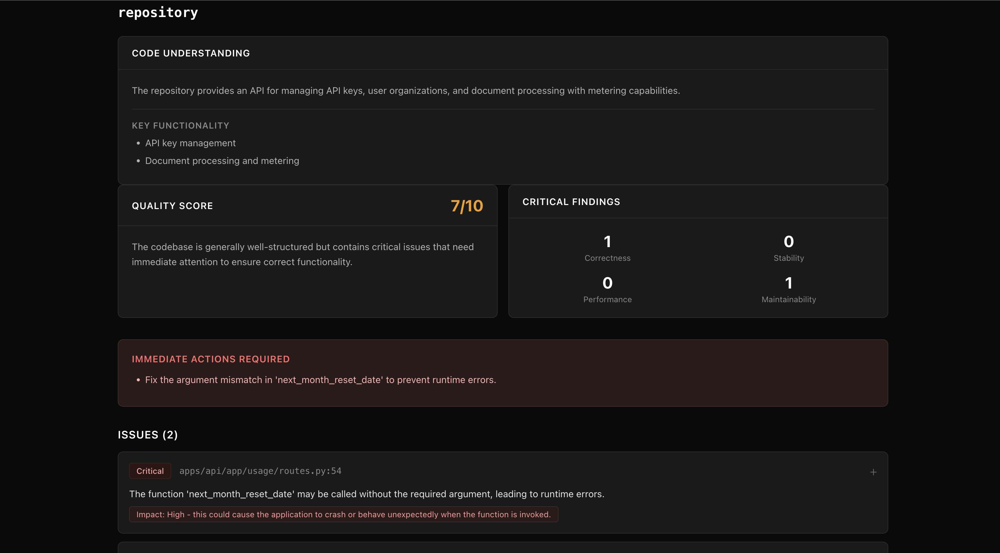
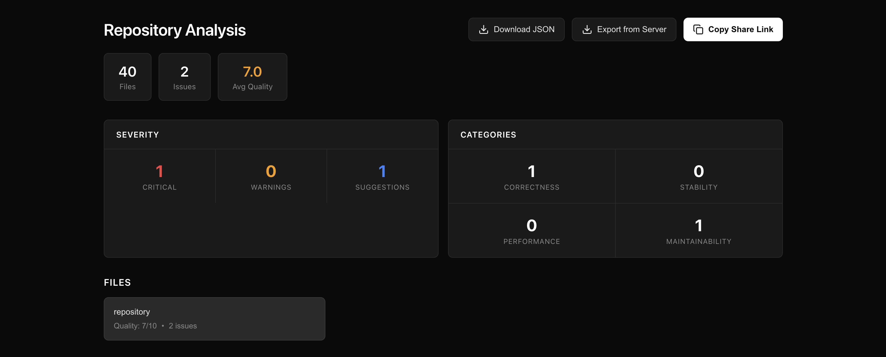

<div align="center">

# Codebase Intelligence

### Find the code risks that matter before they become production problems.

[](https://www.python.org/downloads/)
[](https://fastapi.tiangolo.com/)
[](https://react.dev/)
[](https://docs.docker.com/compose/)
[](https://www.trychroma.com/)
[](LICENSE)

[Quick Start](#quick-start) · [Features](#features) · [Architecture](#architecture) · [Configuration](#configuration) · [API](#api-surface)

</div>

---

## Why this exists

Most AI code review tools sound confident while drowning teams in generic advice. **Codebase Intelligence is built for the opposite:** fast repository understanding, static-analysis evidence, calibrated severity, and review output that helps developers decide what to inspect next.

Point it at a GitHub repo and get a senior-review style snapshot: purpose, quality score, risk categories, file summaries, exportable JSON, share links, and concrete issues tied back to code evidence.

If you are evaluating a codebase, cleaning up a repo for production, or preparing an engineering portfolio project, this is the fastest way to get from “what is in here?” to “what should I fix first?”



---

## Features

- **Repository-level analysis** from public GitHub URLs or authenticated GitHub repo selection.
- **Four specialized analyzers**: dependency/impact graph, AST pattern matching, type-signal checks, and duplicate detection.
- **Fast review mode** optimized for local iteration: one repository-level LLM pass after static evidence collection.
- **Severity calibration and noise filtering** to reduce generic comments and focus on correctness, stability, performance, and maintainability.
- **Progressive UI workflow** with URL input, GitHub OAuth, repository picker, live progress, result dashboard, JSON export, and share links.
- **Optional RAG context** with ChromaDB + OpenAI embeddings for deeper review guidance.
- **Containerized full stack**: FastAPI, React/Nginx, ChromaDB sidecar, SQLite persistence, named Docker volumes, and a private bridge network.

| Analyze by URL | Connect GitHub |
|---|---|
|  |  |

| Pick repositories | Review results |
|---|---|
|  |  |



---

## Quick start

### Option 1: Docker Setup — recommended

This is the primary setup path. It starts the complete local ecosystem:

| Service | URL | Purpose |
|---|---|---|
| Web UI | <http://localhost:3000> | React app served by Nginx |
| API | <http://localhost:8000> | FastAPI analysis backend |
| ChromaDB | <http://localhost:8001> | Optional RAG/vector sidecar |

#### Prerequisites

- Docker Desktop or Docker Engine with Docker Compose v2
- A valid OpenAI API key
- GitHub OAuth credentials only if you want authenticated GitHub browsing. Manual public repo URL analysis works without OAuth.

#### 1. Clone

```bash
git clone https://github.com/Oussamcsc/codebase-intelligence.git
cd codebase-intelligence
```

#### 2. Configure environment

```bash
cp .env.example .env
```

Set at minimum:

```env
OPENAI_API_KEY=your-openai-api-key-here
```

Optional GitHub OAuth:

```env
GITHUB_CLIENT_ID=your-github-client-id-here
GITHUB_CLIENT_SECRET=your-github-client-secret-here
```

For local OAuth, configure your GitHub OAuth App with:

- Homepage URL: `http://localhost:3000`
- Authorization callback URL: `http://localhost:8000/auth/github/callback`

#### 3. Run

```bash
docker compose up --build
```

Open <http://localhost:3000>.

#### 4. Health checks

```bash
curl http://localhost:8000/health
curl http://localhost:8001/api/v1/heartbeat
```

#### 5. Stop / reset

```bash
# Stop containers, keep data
docker compose down

# Stop containers and remove local Docker volumes
docker compose down -v
```

---

### Option 2: Local development without Docker

Use this when actively developing outside containers.

```bash
python3 -m venv .venv
source .venv/bin/activate
pip install -r requirements.txt

cp .env.example .env
uvicorn api:app --host 0.0.0.0 --port 8000 --reload
```

In a second terminal:

```bash
cd web
npm install
npm start
```

Open <http://localhost:3000>.

If local Python virtualenv setup is broken, use `uv`:

```bash
uv python install 3.11
uv venv --python 3.11 .venv
source .venv/bin/activate
uv pip install -r requirements.txt
```

---

## Architecture

```text
Browser
  │
  ▼
React + Nginx (:3000)
  │ HTTP / WebSocket
  ▼
FastAPI API (:8000)
  ├─ Static analyzers: graph, AST patterns, types, duplicates
  ├─ SQLite results DB: /app/data/code_review_results.db
  ├─ ChromaDB sidecar: chroma:8000 / localhost:8001
  └─ OpenAI: review synthesis + optional embeddings
```

### Analysis pipeline

1. Clone the target GitHub repository into a temporary workspace.
2. Discover files and apply `files_pattern` / `MAX_ANALYSIS_FILES` guardrails.
3. Run static analyzers for graph, AST, type, duplicate, and file-level evidence.
4. Filter and rank candidate issues by impact.
5. Optionally retrieve Chroma-backed RAG guidance when `ENABLE_RAG=true`.
6. Run a repository-level OpenAI review synthesis pass.
7. Store job state/results in SQLite and stream progress to the UI.

---

## Performance optimizations

- **Fast mode by default**: `ANALYSIS_MODE=fast` uses a single repository-level LLM call after evidence collection.
- **Latency guardrails**: `MAX_ANALYSIS_FILES=40` prevents accidental long-running local scans.
- **Cheaper default model**: `GPT_REVIEW_MODEL=gpt-4o-mini` keeps local review runs practical.
- **Optional RAG startup**: `ENABLE_RAG=false` keeps cold starts fast; Chroma remains available when deeper context is needed.
- **Lazy reviewer initialization**: health/config endpoints work even before `OPENAI_API_KEY` is configured.
- **Docker persistence**: named volumes keep SQLite and Chroma data across restarts.
- **SPA-safe OAuth redirects**: Nginx serves React routes correctly, and OAuth tokens are handled in URL fragments instead of frontend access logs.

---

## Configuration

`.env.example` is the source template for Docker and non-Docker runs.

| Variable | Default | Purpose |
|---|---:|---|
| `OPENAI_API_KEY` | placeholder | Required for analysis and OpenAI review synthesis. |
| `GITHUB_CLIENT_ID` | empty | Optional GitHub OAuth app client ID. |
| `GITHUB_CLIENT_SECRET` | empty | Optional GitHub OAuth app secret. |
| `BACKEND_URL` | `http://localhost:8000` | Public API URL used for links and OAuth callback construction. |
| `FRONTEND_URL` | `http://localhost:3000` | Public web UI URL used for redirects. |
| `REACT_APP_API_URL` | `http://localhost:8000` | API URL baked into the frontend Docker build. |
| `API_HOST` | `0.0.0.0` | API bind host inside the container/process. |
| `API_PORT` | `8000` | API bind port inside the container/process. |
| `DB_PATH` | `/app/data/code_review_results.db` | SQLite results database path in Docker. |
| `VECTOR_DB_PATH` | `/app/data/chroma_db` | Embedded Chroma path for non-sidecar fallback/dev use. |
| `CHROMA_HOST` | `chroma` | Chroma sidecar hostname on the Docker network. |
| `CHROMA_PORT` | `8000` | Chroma sidecar internal port. Host maps this to `8001`. |
| `EMBEDDING_MODEL` | `text-embedding-3-small` | OpenAI embedding model for optional RAG. |
| `ANALYSIS_MODE` | `fast` | Default reviewer mode: `fast` or `detailed`. |
| `GPT_REVIEW_MODEL` | `gpt-4o-mini` | Default OpenAI chat model for review synthesis. |
| `GPT_TIMEOUT_SECONDS` | `30` | Timeout budget for review synthesis. |
| `MAX_ANALYSIS_FILES` | `40` | Default maximum files analyzed per GitHub job. |
| `ENABLE_RAG` | `false` | Enables Chroma-backed RAG context when set to `true`. |
| `CHROMA_SERVER_HOST` | `0.0.0.0` | Chroma container bind host. |
| `CHROMA_SERVER_HTTP_PORT` | `8000` | Chroma container internal HTTP port. |
| `CHROMA_HOST_PORT` | `8001` | Host port exposed for Chroma debugging. |

Never commit `.env`, generated SQLite files, Chroma data, virtual environments, dependency folders, or build outputs.

---

## Docker Compose services

| Service | Container | Host port | Description |
|---|---|---:|---|
| `api` | `codebase-intelligence-api` | `8000` | FastAPI backend, analyzer orchestration, SQLite persistence. |
| `web` | `codebase-intelligence-web` | `3000` | Production React build served by Nginx. |
| `chroma` | `codebase-intelligence-chroma` | `8001` | ChromaDB sidecar for optional RAG collections. |

Named volumes:

- `codebase-intelligence-api-data` → `/app/data`
- `codebase-intelligence-chroma-data` → `/chroma/chroma`

Network:

- `codebase-intelligence-net` private bridge network

---

## API surface

### Analysis

- `POST /github/analyze` — start repository analysis.
- `GET /github/status/{job_id}` — check analysis status.
- `GET /github/results/{job_id}` — fetch completed results.
- `GET /github/share/{job_id}` — public/shareable result endpoint.
- `GET /github/export/{job_id}/json` — export results as JSON.
- `WS /ws/progress/{job_id}` — stream live progress updates.

Example:

```json
{
  "repo_url": "https://github.com/user/repo",
  "branch": "main",
  "files_pattern": "*.py",
  "max_files": 40,
  "analysis_mode": "fast"
}
```

### Utilities

- `POST /review` — review a code string.
- `POST /review-file` — review a file path available to the backend.
- `POST /upload-review` — upload and review a file.
- `GET /stats` — system stats.
- `GET /health` — health check.
- `GET /auth/github` — start GitHub OAuth flow.
- `GET /auth/github/callback` — OAuth callback handler.

---

## Development checks

```bash
python3 -m py_compile config.py api.py Code_reviewer.py Codebase_analyzer.py pattern_matcher.py type_analyzer.py duplicate_detector.py cli.py scan_project.py
pytest

cd web
npm run build
```

Docker checks:

```bash
docker compose config
docker compose up --build
```

---

## Troubleshooting

**Analysis returns 503**

Set `OPENAI_API_KEY` in `.env`, then recreate the API container:

```bash
docker compose up --build api
```

**Frontend cannot reach backend**

```bash
curl http://localhost:8000/health
```

Confirm `REACT_APP_API_URL=http://localhost:8000` before building the web image.

**GitHub OAuth redirect mismatch**

Use exactly:

- `BACKEND_URL=http://localhost:8000`
- `FRONTEND_URL=http://localhost:3000`
- GitHub callback: `http://localhost:8000/auth/github/callback`

**ChromaDB unavailable**

```bash
docker compose ps chroma
curl http://localhost:8001/api/v1/heartbeat
```

If `ENABLE_RAG=false`, core analysis can still run without RAG.

**Large repo is slow**

Keep `ANALYSIS_MODE=fast`, lower `MAX_ANALYSIS_FILES`, or narrow `files_pattern`.

---

## License

MIT — see [LICENSE](LICENSE).
